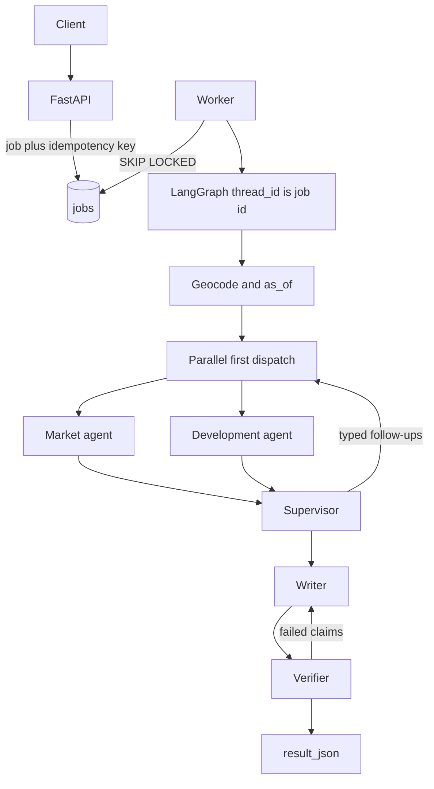

# Shamai

Shamai is a due-diligence engine for a single apartment in Tel Aviv–Yafo.

A caller submits an address, asking price, size, and a profile (`homebuyer` or `investor`). A background worker geocodes the property and runs a LangGraph investigation: a supervisor, a Market agent, and a Development agent query PostGIS through typed tools, write evidence rows, and produce a report. Every material claim is `observed`, `calculated`, or `interpretation`, and is checked against stored evidence before the report is stored. Valuation is a comparable-sales estimate with a published, leakage-free backtest. Agent collaboration is measured against a single-agent baseline.

The repo is a modular monolith: one Python package, one PostgreSQL/PostGIS database, an `api` process, and a `worker` process. Reference loads and backfill use the same module services as the worker. The client is Swagger UI.

Coverage is Tel Aviv–Yafo, restricted to a neighborhood allowlist in config. Addresses that geocode outside that allowlist are rejected.

## Why it exists

Transaction records, planning statuses, and urban-renewal polygons live on separate Hebrew government sites. Summarizing them in a chatbot invents numbers. Shamai treats due diligence as a job with provenance: tools persist evidence, the verifier recomputes or matches cited values, and the report states uncertainty, missing data, and conflicts.

## What a run does

1. `POST /analyses` with `Idempotency-Key` inserts a job and returns `{id, status}` (`202` on first create, `200` on a repeat of the same key and body).
2. The worker claims the job (`FOR UPDATE SKIP LOCKED`), geocodes the address, and sets `as_of` (request date, or today in Asia/Jerusalem).
3. Market and Development run in parallel on the first dispatch (LangGraph `Send`).
4. The supervisor queue issues typed follow-ups until questions are closed or `SHAMAI_MAX_DISPATCHES` (6) is spent. Unanswered required questions become the missing-information section.
5. The writer emits typed claims. The verifier rejects or qualifies failures (at most two rewrite loops).
6. Finalize writes `result_json` on the job. Poll `GET /analyses/{id}` until `done`, `failed`, or `incomplete`. Fetch JSON or Markdown from `GET /analyses/{id}/report`. Audit a row with `GET /evidence/{id}`.

Profiles share the same investigation and tools. They differ in report template and decision emphasis. Investor copy uses historical growth **scenarios** and labels renewal vs non-renewal price gaps as index-adjusted correlation, not causal impact.



Jobs are at-least-once. Expired leases are reaped. A crash before a checkpoint commits re-runs that node, so tools upsert evidence by a canonical hash. LLM cost is written to `llm_calls`. A run or step timeout stores whatever report exists and sets status `incomplete`.

## Investigation

**Market agent** — comparable sales, neighborhood ₪/m² index, asking price vs estimate, transaction detail. Guardrails (not the LLM) enforce `MIN_COMPS` and widen order radius → time → size. The model inspects outlier sales and may request `ExplainPricePremium` or `CompareAroundEvent`.

**Development agent** — plans at the point, `plan_status_events` as of `as_of`, renewal / Pinui-Binui polygons. Conflicting sources become `ResolvePlanConflict`. An approved nearby renewal plan requests an exploratory, index-adjusted price comparison.

Follow-up identity is the typed payload, not free text. Specialists are stateless between dispatches (max 8 tool calls each). Thresholds stay in `app/modules/valuation` constants.

Production uses `build_graph("rules")`. Evaluation also runs `single` (one agent, all tools, 8 tool-call cap, no follow-ups) and `llm` (same queue, LLM only ranks remaining work).

Trajectory tests that must fail if the agents ignore the data: thin comps, outlier comparable, plan conflict, renewal follow-up.

## Valuation

`app/modules/property_data` fetches KNN candidates with `available_at <= as_of`, after checking area coverage. `app/modules/valuation` is pure functions: filter and weight comps, time-adjust with the statistical-area index, apply documented size and floor factors, then a weighted median and IQR band. Baseline is neighborhood median ₪/m² × size. Incomplete coverage is reported as a limitation, not as zero sales.

The backtest splits on `available_at`, never on deal date. Metrics: MAE, MAPE, share within 10%, overall and by segment, always next to the baseline.

## Evidence

Tools upsert evidence (`SHA-256(run, tool, canonical JSON params)` internally; public `id` is a UUID).

| Claim | Meaning | Check |
| --- | --- | --- |
| `observed` | Field from a source payload | Evidence exists; values match (money in agorot, exact counts) |
| `calculated` | Named function | Re-run on cited inputs |
| `interpretation` | Judgment over other claims | Injected LLM judge; failure → `qualified` |

Material claims are numbers, plan/status ids, containment (in/out of a polygon), or asking vs estimate. A material claim without evidence ids fails verification.

## Point-in-time data

Time-sensitive rows store `effective_at`, `published_at`, `retrieved_at`. Loaders set `available_at = coalesce(published_at, effective_at + source lag)` and `available_at_estimated` when the lag is used. Queries filter `available_at <= as_of`.

Plan status is an event table. Snapshot layers set `history_available=false` and are not used for historical replay.

## Data loaded

Licensed module services write, on demand for a searched area or in bulk for a reference dataset:

- Residential transactions (with publication lag documented in `docs/data-sources.md`)
- Tel Aviv urban-renewal / Pinui-Binui polygons
- iplan plan boundaries and status events
- CBS statistical areas
- Geocode cache (municipal address layer, then GovMap)

Raw files stay in gitignored `data/`. A source without a filled row in `docs/data-sources.md` is not loaded.

## HTTP

| Method | Path | Contract |
| --- | --- | --- |
| POST | `/analyses` | Body: address, asking price, size m², `profile`; optional rooms, floor, year, `as_of`. Header `Idempotency-Key`. Same key + different body → `409`. |
| GET | `/analyses/{id}` | `queued` \| `running` \| `verifying` \| `done` \| `failed` \| `incomplete` |
| GET | `/analyses/{id}/report` | JSON DTO; Markdown if `Accept: text/markdown` |
| GET | `/evidence/{id}` | UUID; payload, source, `retrieved_at` |

No `prompt` or `variant` on the API.

## Modules

| Module | Owns | May import |
| --- | --- | --- |
| `app/core` | Config, session, `visible_as_of` | nothing in `app.modules` |
| `app/modules/property_data` | Addresses, transactions, geocode cache, area coverage | `core`; providers only from its service |
| `app/modules/planning` | Plans, status events, renewal polygons, documents | `core`; providers only from its service |
| `app/modules/valuation` | Comp scoring, adjustments, estimate, baseline | nothing in `app` |
| `app/modules/evidence` | Store, claims, verifier, `GET /evidence/{id}` | `core`; `calculations` may import `valuation` |
| `app/modules/investigation` | Analysis HTTP, LangGraph, tools | `jobs`, services, `valuation`, `evidence`, `reporting` |
| `app/modules/reporting` | Report DTO and Markdown | its own DTOs only |
| `app/jobs` | Queue, worker, reaper, checkpointer | `investigation.graph`, `infrastructure.llm` |
| `app/infrastructure/llm` | Model client, `llm_calls` | not `app.modules` |
| `evals` | Backtest and agent scoring | `app` |

Graph and tools do not import repositories, providers, or `valuation`. `app` does not import `evals`. Only `app.main` imports controllers. Module rules: `AGENTS.md` in each package.

## Evaluation

- `python -m evals.valuation.run` — temporal holdout on transactions; comps engine vs baseline.
- `python -m evals.agents.run` — ~15 properties in `evals/agents/golden_set.yaml`; expected findings from the DB; variants `single` / `rules` / `llm`; accuracy, support, completeness, follow-ups, cost from `llm_calls`, latency. Five cases scored by hand in `evals/agents/manual_review.md`.

Results are committed as summaries under `evals/results/`.

## Stack

Python 3.12, uv, FastAPI, Pydantic v2, LangGraph with Postgres checkpointer, PostgreSQL/PostGIS, SQLAlchemy 2, GeoAlchemy2, psycopg 3, Alembic, httpx, shapely, NumPy, pytest, ruff, Docker Compose (`db`, `api`, `worker`), GitHub Actions, import-linter.

```
app/core                         config, session, visible_as_of
app/modules/property_data        transactions, geocode, coverage
app/modules/planning             plans, events, renewal polygons
app/modules/valuation            pricing functions
app/modules/investigation        analysis HTTP, LangGraph, tools
app/modules/evidence             store, verifier, evidence HTTP
app/modules/reporting            report DTO and Markdown
app/jobs                         queue and worker
app/infrastructure/llm           model client and llm_calls
alembic/                         migrations
evals/valuation                  backtest
evals/agents                     agent scoring
tests/                           unit, integration, reliability, trajectory
scripts/spike/                   source probes
docs/                            data-sources and ADRs
```
